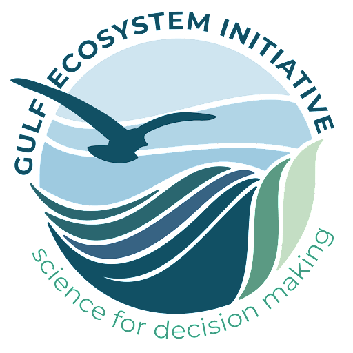

::: column-margin
{width="200px" fig-align="center"}
:::

## Overview

The [National Center for Ecological Analysis and Synthesis (NCEAS)](https://www.nceas.ucsb.edu/){.external target="_blank"}, a research affiliate of UCSB, is a leading expert on interdisciplinary data science and works collaboratively to answer the world's largest and most complex questions. The NCEAS approach leverages existing data and employs a team science philosophy to squeeze out all potential insights and solutions efficiently - this is called [synthesis science](https://www.nceas.ucsb.edu/our-approach){.external target="_blank"}.

NCEAS has over 30 years of success with this model among working groups and environmental professionals. Together with the Delta Science Program and the Delta Stewardship Council we are excited to pass along skills, workflows, mindsets learn throughout the years.

:::{.callout-learning}

After completing this workshop, you will be able to:

* Identify best practices and tools for optimizing collaboration (like Git & GitHub)
* Implement reproducible scientific workflows throughout all aspects of a project
* Summarize scientific analyses and results clearly and effectively by using computational notebook files, GitHub * webpages, and R packages like ggplot2 and shiny

:::

## Code of Conduct

By participating in this activity you agree to abide by the [NCEAS Code of Conduct](https://www.nceas.ucsb.edu/sites/default/files/2021-11/NCEAS_Code-of-Conduct_Nov2021_0.pdf){.external target="_blank"}.

## About this book

These written materials are the result of a continuous and collaborative effort at NCEAS to help researchers make their work more transparent and reproducible. This work began in the early 2000's, and reflects the expertise and diligence of many, many individuals. The primary authors are listed in the citation below, with additional contributors recognized for their role in developing previous iterations of these or similar materials.

This work is licensed under a [Creative Commons Attribution 4.0 International License](http://creativecommons.org/licenses/by/4.0/){.external target="_blank"}.

**Citation:** Casey O'Hara (2026), NCEAS Synthesis Skills Training, November 2026, NCEAS Learning Hub. [https://nceas-learning-hub.github.io/COURSE SITE](https://nceas-learning-hub.github.io/COURSE SITE/){.external target="_blank"}.

**Content contributors:** Ben Bolker, Amber E. Budden, Julien Brun, Angel Chen, Samantha Csik, Halina Do-Linh, Natasha Haycock-Chavez, S. Jeanette Clark, Julie Lowndes, Stephanie Hampton, Matt Jones, Samantha Katz, Nick J. Lyon, Erin McLean, Bryce Mecum, Casey O'Hara, Deanna Pennington, Karthik Ram, Jim Regetz, Tracy Teal, Camila Vargas Poulsen, Daphne Virlar-Knight, Leah Wasser.

This is a Quarto-built website. To learn more about Quarto sites visit [https://quarto.org/docs/websites/](https://quarto.org/docs/websites){.external target="_blank"}.

